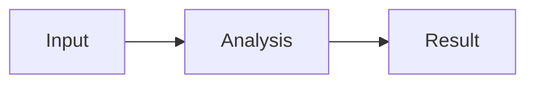

# Inline conversation visualizations

English | [中文](inline-visualizations-design_20261010.zh.md)

Design reference dated 2026-10-10. The user has approved the product direction; this document specifies the proposed implementation for review. Examples describe proposed syntax, not commands or APIs available in the current application. After implementation, maintained behavior belongs in the owning package READMEs.

## Summary

Assistant replies can interleave explanations with HTML panels, interactive charts, and diagrams. Explicitly marked code blocks show a preview by default, with source, enlargement, and download actions. Bundled components and themes reduce repetitive styling code; short system guidance and an on-demand skill teach the model how to use them. Ordinary code blocks retain their current presentation.

## Table of Contents

- [Experience and scope](#experience)
- [Code block protocol](#protocol)
- [Libraries and authoring](#libraries)
- [Rendering and isolation](#rendering)
- [History and export](#history)
- [Model instructions](#instructions)
- [Repository integration](#integration)
- [Acceptance and validation](#acceptance)

<a id="experience"></a>
## Experience and scope

The first release covers HTML/CSS/JavaScript panels, ECharts charts, and Mermaid diagrams in assistant prose. A user can request a comparison, adjust a filter inside a generated panel, or ask the model for a revised visualization in a later reply. Each revised reply retains its own complete source; earlier replies remain unchanged.

Each preview has localized Preview, Source, Copy, Enlarge, and Download actions. It fills the message width, adapts to narrow screens and the application theme, and provides an accessible title derived from its content or a localized fallback. Enlargement uses an in-page overlay around the same mounted frame so opening and closing it retains interaction state. This release does not create a second, independently running sidebar copy.

Interaction stays inside the generated document. Reloading a conversation restores its authored initial values. Form values and filter selections are not durable, and clicking a panel control does not implicitly send a model request or execute a Host operation. React/JSX compilation, runtime package installation, external-data connectors, and editing source directly in the preview are outside this release.

<a id="protocol"></a>
## Code block protocol

Only top-level fenced blocks in assistant text with the explicit `preview` marker enter the preview renderer. User messages, reasoning, tool output, quoted examples, nested list fences, and ordinary document previews do not execute through this feature. The opening language is exactly `html` or `mermaid`; ordinary fences without `preview` remain source, including ordinary `mermaid` fences.

The first protocol uses `runtime=dsh-v1`. HTML optionally declares `libs=echarts`; Bootstrap styling and its bundled controls are available without another declaration. Mermaid selects its own bundled renderer. Metadata consists of whitespace-separated tokens with no quoted values; duplicate keys, unknown keys, unknown libraries, and unsupported runtimes produce a localized diagnostic with readable source. No renderer guesses a replacement runtime.

The following is an authoring example for a metric panel:

````text
```html preview runtime=dsh-v1
<section class="card">
  <div class="card-body">
    <div class="text-body-secondary">Monthly requests</div>
    <div class="display-6">12,480</div>
  </div>
</section>
```
````

The following is an authoring example for a diagram:

````text

````

A closed fence can render while the remaining reply continues streaming. The Markdown parser must report explicit closure; CommonMark accepting an unfinished fence at end-of-input is not sufficient. Open or interrupted unclosed blocks show source and generation status without executing. Frozen blocks retain source-offset identity through streaming and final parsing; appending later prose must not reload an existing frame. Unsupported nested preview fences remain ordinary source.

<a id="libraries"></a>
## Libraries and authoring

| Purpose | Initial selection | Model responsibility |
|---|---|---|
| Cards, grid, forms, tables, tabs | Bootstrap 5.3.8, including its bundled control dependencies | HTML composition, text, and data |
| Statistical charts | ECharts 6.1.0 | Chart options and inline data |
| Flowcharts, sequence and architecture diagrams | Mermaid 11.16.0, already pinned in the repository | Diagram source |
| Theme and chart defaults | A small application-owned adapter | Exceptional styling only |

Bootstrap supplies ready-made HTML classes and controls without a JSX compiler or model-authored utility CSS. The adapter maps the application's public theme values to Bootstrap variables, spacing, typography, and chart colors. Custom styles remain scoped to the iframe. The preview document sets its own light or dark theme, including Bootstrap's theme attribute.

The HTML environment exposes the pinned `bootstrap` API and, when requested, `echarts`. A single helper, `dsh.chart(element, option)`, creates an ECharts instance with the shared theme, applies the supplied option, observes resizing, and returns the native chart instance. Explicit options override visual defaults. Theme changes update registered charts without rebuilding the whole HTML document. This helper introduces no separate chart schema or general-purpose UI language.

Only preview bootstrap code belongs in the feature's entry bundle. Bootstrap assets load when an HTML preview is needed; ECharts and Mermaid load only for their declared preview kinds. Assets come from the packaged application and enter the sandbox as bytes. Model output does not supply CDN URLs or package versions. Build output retains dependency licenses and checks the renderer's dependency graph separately from the main chat bundle.

The Bootstrap and ECharts versions above were checked against npm registry metadata on 2026-10-10; Mermaid is pinned by the current repository. Runtime compatibility and visual quality still require implementation tests. These version selections do not constitute a claim that the libraries already run in this application.

<a id="rendering"></a>
## Rendering and isolation

Each visualization runs in an opaque iframe with `sandbox="allow-scripts"`, without same-origin access, forms, popups, top navigation, or direct downloads. Mermaid also renders inside this document; generated SVG never enters the application DOM. The iframe has no Host RPC, credentials, file-reader callback, or model-tool interface. The existing sidebar HTML implementation provides a reference for constructing Blob resources inside the opaque frame, but inline previews have their own loading and message lifecycle.

A trusted bootstrap installs the theme, declared assets, and a small message channel before running authored content. It reports readiness, bounded height changes, and rendering errors. Export responses travel over the same channel only after an explicit user action. The parent validates message fields and payload size, binds the channel to the current frame and generation, and ignores messages from replaced frames. Model-authored code must not gain a general parent-message dispatcher.

An application-owned Content Security Policy precedes authored content: ordinary remote scripts, styles, images, fonts, fetches, frames, workers, and form submissions are disabled; inline author scripts and packaged Blob resources are allowed as needed. The source and generated dependency set must satisfy this policy without external network access. Script-driven navigation of the iframe itself is a browser limitation, not something this design claims CSP universally prevents; leaving the controlled document invalidates the preview channel and exposes Reload and Source. Stronger network or CPU confinement would require a separate runtime design.

The plugin resolves and validates deployment limits at load. Initial configuration defaults are 256 KiB of UTF-8 source per block, 32 MiB per export, four simultaneously active previews, a frame height range of 180–640 CSS pixels with inner scrolling, and a 15-second readiness timeout. Deployment configuration can change these limits. Source and library metadata are validated before asset loading. A preview outside the active-view budget shows a lightweight placeholder and remounts from its original source when activated. This resets transient interaction state; switching Source/Preview or enlarging the same active frame does not. Slow readiness, invalid diagrams, and script errors leave the reply readable and allow explicit retry. A main-thread busy loop is not covered by a readiness timeout guarantee.

Frame disposal removes message handlers, observers, pending asset subscribers, and Blob URLs. Late readiness or export responses cannot update another block. Shared immutable assets can be cached by runtime identifier; session-owned source, input values, and rendered documents cannot be shared across conversations.

<a id="history"></a>
## History and export

The assistant's existing recorded text contains the complete source, inline data, runtime identifier, and declared libraries. No new Session event is needed merely to display those bytes. The design adds no Host-file-path dependency and no persisted DOM, iframe URL, or browser state. Both SDKs continue to receive the same assistant text, including marked fences, even when their consumers have no preview renderer.

`dsh-v1` identifies the frozen authoring API, theme defaults, and dependency manifest. Releases retaining this runtime keep those assets available; an incompatible runtime receives a new identifier. If a runtime is unavailable or must be disabled for a security reason, history retains source viewing and source download with an explicit unavailable-preview state; runnable HTML and rendered-image exports are unavailable. It does not silently run old source against a different library version. Reproduction means the same source, data, and supported API, not pixel-identical fonts across operating systems or deterministic arbitrary JavaScript.

HTML download produces a self-contained document with the declared runtime assets embedded. It opens offline and restores the authored initial state; it does not serialize a running DOM. The downloaded HTML executes in the user's browser rather than the application's iframe. Mermaid supports SVG and source export. ECharts instances created by `dsh.chart` support PNG export, with a chooser when more than one chart exists. Arbitrary HTML has no promised PNG or SVG export.

Download filenames use a sanitized content title followed by the user's local `YYYYMMDD` date; repeated names on the same day receive `_02`, `_03`, and so on. Application code initiates downloads after user gestures, validates returned MIME types and sizes, and treats exported SVG as downloadable bytes rather than application markup.

<a id="instructions"></a>
## Model instructions

The visualization plugin contributes a short system section only in a composition that supplies the preview UI, runtime manifest, skill registry, and skill loader. Missing declared dependencies fail at load. Removing the feature removes its prompt and skill candidates. The section describes when visualization helps, requires loading the appropriate skill before authoring, and distinguishes marked preview blocks from code examples.

Three bundled skills provide bounded instructions: `visualize-html` for components and interactions, `visualize-charts` for ECharts and `dsh.chart`, and `visualize-diagrams` for Mermaid. Each includes the exact supported marker, runtime identifier, library access, a minimal example, and relevant limitations. Their catalog summaries stay brief; complete instructions load through the existing skill tool and remain in recorded tool history. The HTML and chart skills may share an owned reference asset without duplicating a complete library manual.

The runtime manifest supplies the supported identifiers and library versions to both the packaged assets and the generated skill instructions. Verification rejects an advertised library or runtime missing from the packaged renderer. The system section itself contains no complete API catalog. Users can request a diagram explicitly; the model can also choose one when it materially improves comparison or understanding, while simple facts and code explanations remain concise text or ordinary code.

The proposed system section has these obligations:

- Use inline visualizations when charts, diagrams, or interactive panels materially improve the answer.
- Load the matching visualization skill before generating a preview, and follow its explicit code-block protocol.
- Prefer the provided components, theme, and libraries; emit content, inline data, and necessary interaction logic.
- Keep ordinary code examples unmarked; do not invent libraries, Host access, external-data support, or persisted input state.
- Use complete code and explicit data units; label demonstration data rather than presenting it as verified evidence.

<a id="integration"></a>
## Repository integration

| Owner | Proposed responsibility |
|---|---|
| `packages/client/ui-primitives` | Preserve fence language, metadata, and closure information; expose a pure optional code-rendering callback with ordinary-code fallback |
| `packages/client/ui-chat` | Declare the assistant-only preview slot and pass its framework-provided renderer to Markdown; other Markdown consumers retain their behavior |
| `packages/client/ui-visualizations` | New plugin owning the slot provider, preview frame, controls, runtime assets, validated configuration, short prompt section, and bundled skill provider |
| `packages/bundle/web-app` | Compose the feature and its declared dependencies for Web and the shared Desktop UI |
| `apps/web/tests` and `snapshots` | Exercise the shipped composition and recorded model output |

The primitives remain Cordis-free and do not import Bootstrap, ECharts, Mermaid, or the new plugin. Cross-plugin React content uses the existing slot system rather than ReactNode-valued injected callbacks. Slot data contains only serializable source, metadata, lifecycle identity, and declared plain callbacks. Registrations follow effect lifetimes. The agent loop and the existing file-delivery event are unchanged by this design.

Current implementation references are [Markdown rendering](../../../packages/client/ui-primitives/src/markdown/render.tsx), [assistant rendering](../../../packages/client/ui-chat/src/client/chat/AssistantMarkdown.tsx), [HTML preview](../../../packages/client/ui-sidebar-documentpreview/README.md), [system sections](../../../packages/core/system-prompt/README.md), and [skill loading](../../../packages/skill/tool-skill/README.md). The integration follows the [client rules](../../../packages/client/AGENTS.md), [Session format policy](../../session-format-status.md), and [testing policy](../../testing.md).

<a id="acceptance"></a>
## Acceptance and validation

| Case | Required evidence |
|---|---|
| Natural-language comparison | A real model emits a marked ECharts preview with matching labels, units, and data; hovering and legend controls work |
| Interactive panel | Bootstrap layout and controls work with no model-authored base stylesheet; a filter updates the displayed data |
| Diagram | A marked Mermaid block renders and exports SVG; invalid syntax shows a local error and preserves source |
| Streaming | Closing a fence starts its preview once; subsequent chunks and settling preserve the instance; an unclosed interrupted fence never executes |
| Scope and protocol | User text, reasoning, tool results, ordinary code, and nested examples do not execute; unknown runtime or metadata shows a diagnostic |
| History | Restarting the Host and reopening the conversation reproduces original source and initial data; a later revision does not replace earlier replies |
| Isolation | Parent DOM and Host access fail; blocked remote resource loads, malformed or stale messages, and oversized exports cannot reach privileged operations |
| Lifecycle | Source switching and enlargement preserve an active instance; budget eviction, retry, connection replacement, and unmount retire owned resources |
| Export | HTML works offline, Mermaid SVG opens as an image, chart PNG matches its current chart, and names follow the date rule |
| Prompt and packaging | Disabled composition advertises no visualization capability; all advertised runtimes and libraries exist; ordinary chat does not load chart bundles |
| Accessibility and layout | Keyboard operation, focus restoration, narrow and wide widths, Chinese and English controls, and light and dark themes are verified |

Focused parser, component, runtime-packaging, and prompt-provider tests cover valid and rejected inputs. Browser tests cover the real iframe, exports, lifecycle, and message isolation. A keyless recorded-session scenario captures skill loading and marked assistant output; a real-model run through the shipped Web profile verifies generation and supplies the interaction GIF required for a GUI pull request. Persistence and both SDK projections are checked if implementation changes recorded types or their expected outputs.

Documentation and model-experience text accompany implementation in paired READMEs and the owning references. The implementation plan selects focused tests and build checks from the actual diff, following the repository's pre-push policy. This design review has not run the proposed application behavior and is not evidence that the feature passes those acceptance cases.

## Dev Note

Implementation planning follows review of this design. The source and paired document remain the review artifacts until behavior moves to the package-owned documentation.
