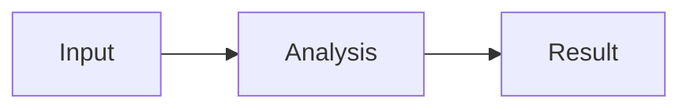

# 会话内可视化

[English](inline-visualizations-design_20261010.md) | 中文

设计参考文档，日期为 2026-10-10。用户已确认产品方向；本文明确拟议实现，供审阅。示例描述拟议语法，不代表当前应用已提供相应命令或 API。实现完成后，持续维护的行为说明归属各包的 README。

## 概要

助手回复可以在解释文字之间嵌入 HTML 面板、交互图表和流程图。显式标记的代码块默认显示预览，并提供源码、放大和下载操作。预置组件和主题减少重复样式代码；简短系统提示与按需加载的 skill（技能）指导模型使用这些能力。普通代码块保持现有展示方式。

## 目录

- [体验与范围](#experience)
- [代码块协议](#protocol)
- [库与编写方式](#libraries)
- [渲染与隔离](#rendering)
- [历史与导出](#history)
- [模型指令](#instructions)
- [仓库集成](#integration)
- [验收与验证](#acceptance)

<a id="experience"></a>
## 体验与范围

首版覆盖助手正文中的 HTML/CSS/JavaScript 面板、ECharts 图表与 Mermaid 图示。用户可以请求比较、在生成的面板中调整筛选条件，或在后续回复中要求模型修改可视化。每次修改后的回复保留自己的完整源码；之前的回复保持原样。

每个预览提供本地化的预览、源码、复制、放大和下载操作。预览占满消息宽度，适配窄屏与应用主题，并使用内容标题或本地化默认标题作为无障碍名称。放大通过包围同一已挂载 iframe 的页内覆盖层实现，因此打开和关闭时保留交互状态。本版本不在侧栏创建另一份独立运行的预览。

交互限定在生成的文档内。重新加载会话恢复编写时的初始值。表单值与筛选选择不持久化，点击面板控件不会隐式发送模型请求或执行 Host 操作。React/JSX 编译、运行时安装软件包、外部数据连接器，以及在预览内直接编辑源码均不属于本版本。

<a id="protocol"></a>
## 代码块协议

只有助手正文中带显式 `preview` 标记的顶层围栏代码块进入预览渲染器。用户消息、推理、工具输出、引用示例、列表内嵌套围栏，以及普通文档预览都不会通过此功能执行。起始语言必须为 `html` 或 `mermaid`；没有 `preview` 的普通围栏仍显示源码，包括普通 `mermaid` 围栏。

首版协议使用 `runtime=dsh-v1`。HTML 可选声明 `libs=echarts`；Bootstrap 样式及其预置控件无需额外声明即可使用。Mermaid 选择自己的预置渲染器。元数据由空白分隔的 token 组成，不支持带引号的值；重复键、未知键、未知库和不支持的运行时均显示本地化诊断，并保留可读源码。渲染器不推测替代运行时。

以下是指标面板的编写示例：

````text
```html preview runtime=dsh-v1
<section class="card">
  <div class="card-body">
    <div class="text-body-secondary">Monthly requests</div>
    <div class="display-6">12,480</div>
  </div>
</section>
```
````

以下是流程图的编写示例：

````text

````

围栏闭合后，即使回复其余部分仍在流式输出，也可以开始渲染。Markdown 解析器必须报告显式闭合；CommonMark 在输入末尾接受未闭合围栏不代表满足执行条件。未闭合或被中断的未闭合块显示源码和生成状态，不执行。冻结代码块在流式和最终解析之间保持以源码偏移为基础的身份；追加后续文字不能重新加载已有 iframe。不支持的嵌套预览围栏仍显示普通源码。

<a id="libraries"></a>
## 库与编写方式

| 用途 | 初始选型 | 模型负责的内容 |
|---|---|---|
| 卡片、网格、表单、表格、标签页 | Bootstrap 5.3.8，包含其控件所需的预置依赖 | HTML 组合、文字与数据 |
| 统计图表 | ECharts 6.1.0 | 图表配置和内嵌数据 |
| 流程图、时序图与架构图 | 仓库已固定版本的 Mermaid 11.16.0 | 图示源码 |
| 主题与图表默认值 | 少量由应用维护的适配代码 | 特殊样式 |

Bootstrap 提供现成的 HTML 类名和控件，无需 JSX 编译器，也无需模型编写工具类 CSS。适配代码将应用公开的主题值映射到 Bootstrap 变量、间距、字体及图表颜色。自定义样式限定在 iframe 内。预览文档设置自己的浅色或深色主题，包括 Bootstrap 的主题属性。

HTML 环境提供固定版本的 `bootstrap` API，并在声明后提供 `echarts`。唯一的辅助函数 `dsh.chart(element, option)` 使用共享主题创建 ECharts 实例，应用传入配置、观察尺寸变化，并返回原生图表实例。显式选项覆盖视觉默认值。主题变化更新已登记的图表，不重建整个 HTML 文档。这个辅助函数不引入另一套图表 schema 或通用 UI 语言。

功能入口包只包含预览启动代码。需要 HTML 预览时加载 Bootstrap 资源；ECharts 和 Mermaid 仅为声明的预览类型加载。资源来自应用安装包，以字节形式进入沙箱。模型输出不提供 CDN 地址或软件包版本。构建产物保留依赖许可证，并独立检查渲染器依赖图与聊天主包的分离。

上述 Bootstrap 和 ECharts 版本已于 2026-10-10 对照 npm registry 元数据核实；Mermaid 使用当前仓库固定的版本。运行时兼容性和视觉质量仍需实现测试。这些版本选型不代表相关库已经在此应用中运行。

<a id="rendering"></a>
## 渲染与隔离

每个可视化在具有不透明源的 iframe 中运行，使用 `sandbox="allow-scripts"`，不开放同源访问、表单提交、弹窗、顶层导航或直接下载。Mermaid 也在该文档内渲染；生成的 SVG 不进入应用 DOM。iframe 不持有 Host RPC、凭据、文件读取回调或模型工具接口。已有侧栏 HTML 实现可供参考，帮助在不透明 iframe 内构造 Blob 资源；内嵌预览拥有自己的加载和消息生命周期。

可信启动代码先安装主题、声明的资源和小型消息通道，再运行生成内容。通道报告就绪、受限的高度变化与渲染错误。导出响应仅在用户显式操作后通过同一通道返回。父页面校验消息字段与负载大小，将通道绑定到当前 iframe 及其代次，并忽略已替换 iframe 的消息。模型生成的代码不能获得通用父页面消息分发接口。

应用控制的 Content Security Policy 在生成内容之前生效：禁用普通远程脚本、样式、图片、字体、fetch、子框架、Worker 和表单提交；按需允许内嵌脚本与预置 Blob 资源。源码及生成的依赖集合必须无需外网即可满足此策略。脚本驱动 iframe 自身导航是浏览器限制，本设计不声称 CSP 能普遍阻止它；离开受控文档会使预览通道失效，并显示重新加载和源码操作。更强的网络或 CPU 隔离需要另行设计运行时。

插件在加载时解析并校验部署限制。初始配置默认值为每块 256 KiB UTF-8 源码、每次导出 32 MiB、同时四个活动预览、180–640 CSS 像素的 iframe 高度范围并允许内部滚动，以及 15 秒就绪超时。部署配置可以修改这些限制。源码和库声明在资源加载前完成校验。超出活动视图配额的预览显示轻量占位，激活时从原始源码重新挂载。这会重置临时交互状态；同一活动 iframe 的源码/预览切换或放大不会重置状态。就绪缓慢、无效图示和脚本错误都保留可读回复，并允许显式重试。主线程死循环不属于就绪超时能保证处理的范围。

销毁 iframe 时移除消息处理器、观察器、等待中的资源订阅与 Blob URL。迟到的就绪或导出响应不能更新其他代码块。共享的不可变资源可按运行时标识缓存；属于会话的源码、输入值和渲染文档不能跨会话共享。

<a id="history"></a>
## 历史与导出

助手已有的文本记录包含完整源码、内嵌数据、运行时标识与库声明。仅展示这些字节不需要新增 Session 事件。本设计不增加 Host 文件路径依赖，不持久化 DOM、iframe URL 或浏览器状态。两种 SDK 继续接收相同的助手文本，包括带标记的围栏，即使调用方没有预览渲染器。

`dsh-v1` 标识固定的编写 API、主题默认值和依赖清单。保留此运行时的发行版继续提供对应资源；不兼容的运行时使用新标识。如果运行时不可用，或因安全原因必须禁用，历史仍保留源码查看与源码下载，并明确显示预览不可用；可运行 HTML 与渲染图片导出不可用。不会静默使用其他版本的库执行旧源码。还原指相同源码、数据和受支持 API，不保证不同操作系统字体逐像素相同，也不保证任意 JavaScript 的确定性。

HTML 下载生成内嵌所声明运行时资源的自包含文档。文档可离线打开，恢复编写时的初始状态，不序列化运行中的 DOM。下载的 HTML 在用户浏览器中执行，不再处于应用 iframe 内。Mermaid 支持 SVG 和源码导出。通过 `dsh.chart` 创建的 ECharts 实例支持 PNG 导出，存在多个图表时提供选择器。任意 HTML 不承诺 PNG 或 SVG 导出。

下载文件名使用经过清理的内容标题，后接用户本地日期 `YYYYMMDD`；同日重名追加 `_02`、`_03` 等序号。应用代码在用户操作后发起下载，校验返回的 MIME 类型与大小，并将导出的 SVG 作为下载字节处理，不作为应用标记渲染。

<a id="instructions"></a>
## 模型指令

可视化插件只在同时提供预览 UI、运行时清单、skill registry 和 skill loader 的组合中贡献简短系统提示片段。缺失声明依赖时在加载阶段报错。移除功能时同时移除提示与 skill 候选。提示片段说明何时可视化有帮助，要求编写前加载适用的 skill，并区分带标记的预览块和代码示例。

三个预置 skill 分别提供范围明确的指令：`visualize-html` 负责组件与交互，`visualize-charts` 负责 ECharts 和 `dsh.chart`，`visualize-diagrams` 负责 Mermaid。每个 skill 包含准确支持的标记、运行时标识、库访问方式、最小示例与相关限制。目录摘要保持简短；完整指令通过已有 skill 工具加载，并保留在工具历史中。HTML 与图表 skill 可以共享一份有明确归属的参考资源，避免重复整本库手册。

运行时清单同时向预置资源和生成的 skill 指令提供受支持标识与库版本。验证必须拒绝宣传安装包渲染器中不存在的库或运行时。系统提示本身不包含完整 API 目录。用户可以显式请求图表；模型也可以在明显有助于比较或理解时主动选择可视化，而简单事实和代码解释保持简洁文字或普通代码。

拟议系统提示包含以下义务：

- 当图表、流程图或交互面板能明显改善回答时，使用会话内可视化。
- 生成预览前加载适用的可视化 skill，并遵循其显式代码块协议。
- 优先使用提供的组件、主题与库，输出内容、内嵌数据和必要交互逻辑。
- 普通代码示例不添加预览标记；不虚构库、Host 访问、外部数据支持或输入状态持久化能力。
- 使用完整代码和明确的数据单位；演示数据必须标明，不能当作已验证依据。

<a id="integration"></a>
## 仓库集成

| 归属 | 拟议职责 |
|---|---|
| `packages/client/ui-primitives` | 保留围栏语言、元数据和闭合信息；提供纯粹的可选代码渲染回调，缺省显示普通代码 |
| `packages/client/ui-chat` | 声明仅限助手正文的预览 slot，并把框架提供的渲染器传给 Markdown；其他 Markdown 消费方保持原有行为 |
| `packages/client/ui-visualizations` | 新插件，负责 slot provider、预览 iframe、控件、运行时资源、经过校验的配置、简短提示片段与预置 skill provider |
| `packages/bundle/web-app` | 为 Web 与共享该 UI 的 Desktop 组合此功能及其声明依赖 |
| `apps/web/tests` 与 `snapshots` | 验证正式组合与记录的模型输出 |

基础组件保持不依赖 Cordis，不导入 Bootstrap、ECharts、Mermaid 或新插件。跨插件 React 内容通过已有 slot 系统传递，不注入返回 ReactNode 的回调。slot 数据仅包含可序列化源码、元数据、生命周期标识与声明的普通回调。注册遵守 effect 生命周期。本设计不修改 agent loop 或已有文件交付事件。

当前实现参考包括 [Markdown 渲染](../../../packages/client/ui-primitives/src/markdown/render.tsx)、[助手正文渲染](../../../packages/client/ui-chat/src/client/chat/AssistantMarkdown.tsx)、[HTML 预览](../../../packages/client/ui-sidebar-documentpreview/README.zh.md)、[系统提示片段](../../../packages/core/system-prompt/README.zh.md)与 [skill 加载](../../../packages/skill/tool-skill/README.zh.md)。集成遵循[客户端规则](../../../packages/client/AGENTS.md)、[Session 格式政策](../../session-format-status.zh.md)与[测试政策](../../testing.zh.md)。

<a id="acceptance"></a>
## 验收与验证

| 场景 | 必需证据 |
|---|---|
| 自然语言比较 | 真实模型输出带标记的 ECharts 预览，标签、单位与数据一致，悬停与图例控件可用 |
| 交互面板 | 无需模型编写基础样式表即可使用 Bootstrap 布局与控件，筛选会更新展示数据 |
| 图示 | 带标记的 Mermaid 块渲染并导出 SVG；无效语法显示局部错误并保留源码 |
| 流式输出 | 围栏闭合后预览仅启动一次；后续片段与完成状态保留实例；被中断的未闭合围栏始终不执行 |
| 范围与协议 | 用户文本、推理、工具结果、普通代码与嵌套示例均不执行；未知运行时或元数据显示诊断 |
| 历史 | 重启 Host 并重新打开会话后还原原始源码与初始数据；后续修改不替换之前的回复 |
| 隔离 | 父页面 DOM 与 Host 访问失败；被阻止的远程资源加载、错误或过期消息、超大导出都不能触发特权操作 |
| 生命周期 | 源码切换与放大保留活动实例；配额淘汰、重试、连接替换与卸载释放归属资源 |
| 导出 | HTML 可离线使用，Mermaid SVG 可作为图片打开，图表 PNG 对应当前图表，命名遵循日期规则 |
| 提示与打包 | 禁用功能的组合不宣传可视化能力；所有宣传的运行时与库实际存在；普通聊天不加载图表包 |
| 无障碍与布局 | 验证键盘操作、焦点恢复、窄宽屏、中英文控件及浅深色主题 |

聚焦的解析器、组件、运行时打包与提示供应测试覆盖有效和拒绝输入。浏览器测试覆盖真实 iframe、导出、生命周期和消息隔离。无密钥记录会话场景捕获 skill 加载与带标记的助手输出；通过正式 Web profile 的真实模型运行验证生成能力，并提供 GUI PR 所需的交互 GIF。如果实现修改了记录类型或预期输出，还需检查持久化与两种 SDK 的投影。

实现时同时更新配对 README 与归属参考文档中的说明及 Model Experience 内容。实施计划遵循仓库推送前政策，根据实际差异选择聚焦测试与构建检查。本次设计审阅尚未运行拟议应用行为，不构成功能通过这些验收项的证据。

## 开发说明

本设计审阅后进入实施规划。行为迁入包归属文档前，源文档与配对文档作为审阅产物保留。
