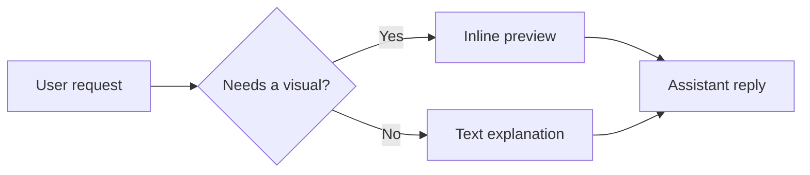

# Inline diagrams

Use a diagram when relationships or a sequence are clearer visually. Prefer short labels and a small graph; explain the main result in surrounding prose. Use prose or a list for a single relationship.

Emit a top-level assistant fence opened with `mermaid preview runtime={{runtime}}` and explicitly close it. Write Mermaid source directly, without HTML or script wrappers. Ordinary, nested and unclosed fences do not execute. The packaged renderer is Mermaid {{mermaid}} with strict security. Remote icons, images, fonts, links that require Host callbacks and HTML execution are unavailable. Keep all labels and diagram data inline; there is no network, parent DOM, filesystem or Host access.

Use flowcharts for processes, sequence diagrams for message order and state diagrams for state transitions. Quote labels containing punctuation when Mermaid requires it. Avoid wide diagrams that depend on a desktop viewport. Do not add `libs=echarts` to a Mermaid fence. Bootstrap {{bootstrap}} and ECharts {{echarts}} belong to HTML previews; load visualize-html or visualize-charts when the task needs those capabilities.

The viewer renders SVG only inside the isolated frame and offers SVG and original Mermaid source downloads. It cannot export Mermaid PNG/PDF or inject SVG into the application DOM. Export filenames use a sanitized title with `YYYYMMDD`, plus a sequence for repeated names. Use separate file tools when the user needs another format or publication-ready layout.

Preview state is transient. Source/Preview and enlargement retain an active frame; Reload, eviction and reopening reconstruct the original diagram. Do not represent local interaction as saved data or a message sent to the assistant.
